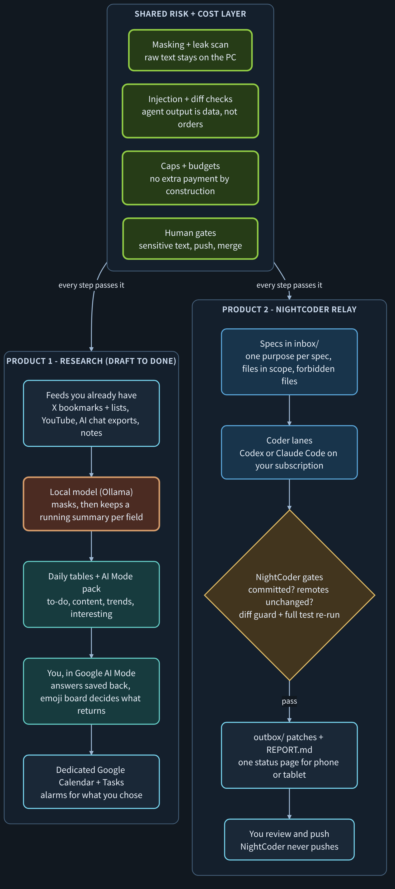
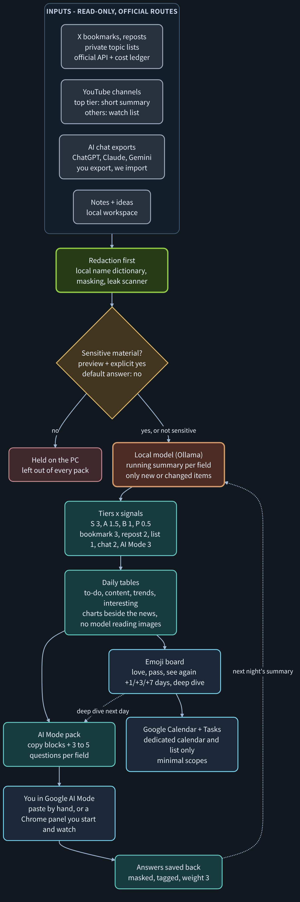
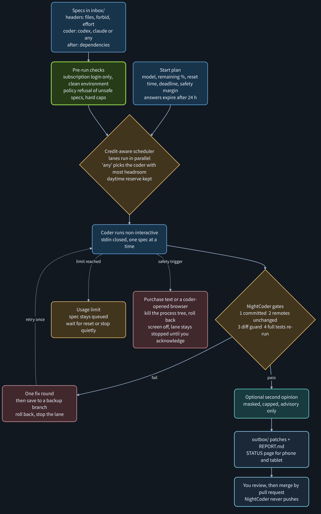

# NightCoder: Draft to Done

*Personal multi-agent orchestrator, in two parts: **Research** that digests your feeds into a daily plan, and a **Relay** that builds code overnight. Both run on one PC, on subscriptions you already pay for.*

> Updated 2026-10-31. The portfolio overview and the original proposed architecture live in
> [ai-multi-agent-orchestration](https://github.com/ai-agent-orchestrator/ai-multi-agent-orchestration).
> This repository documents the design. The NightCoder source code is kept private for now; the plan to release the two products separately is under [Release plan](#release-plan-two-separate-packages).

*One PC, no server, no API spend. The shared layer is enforced by code, never by an agent's goodwill.*

## Two products, two audiences

| | Research (Draft to Done) | NightCoder Relay |
| --- | --- | --- |
| For | people who read a lot (X, YouTube, AI chats) and lose the thread | people who already code with Codex or Claude Code and want queued, gated night runs |
| Input | your bookmarks, private lists, channels, exported chat logs, notes | spec files you or your CTO-agent write |
| Output | daily tables, an AI Mode question pack, an emoji board, Calendar and Tasks alarms | patches and a `REPORT.md` per spec, one status page |
| Human step | you ask the questions in Google AI Mode and pick what comes back | you review and merge by pull request |
| Runs on | local model (free) plus optional Gemini CLI | Codex CLI / Claude Code CLI on your subscription |
| Shares | masking, injection checks, caps and budgets, human approval gates | the same |

Principle: two or three strong agents beat a swarm of weak bots, unless the workflow is fixed in advance. Connecting strong agents is what every developer wants to try; the part that must not be skipped is the risk and cost module between them.

## Roles

| Role | Agent | Runs on | Cost |
| --- | --- | --- | --- |
| Privacy gateway: mask + compress drafts | Meta Llama via Ollama | local PC | free |
| Brain: research reasoning, product PRD | Google Gemini CLI / Google AI Mode | Google account | free tier |
| CTO: design, contracts, specs, final review | Claude | subscription | subscription |
| Engineering lead: build, test, commit | Codex CLI | subscription | subscription |
| Second builder or reviewer | Claude Code CLI | subscription | subscription |
| Relay and gates | NightCoder (`nc2.py`) | local PC | free |
| Research pipeline | `daily.py` and helpers | local PC | free |
| Second opinion on diffs (optional) | `gemini-api` (Gemini API CLI) | API key, free tier | capped |

## Product 1: Research (Draft to Done)

Read-only inputs, a local model first, and a human in the loop for the thinking. Nothing posts, likes, or sends on your behalf.

**Inputs (official routes only)**

- X: your bookmarks, reposts and private topic lists through the official API (OAuth2 with PKCE, five read-only scopes, no app secret). Costs are tracked in an editable estimate ledger with per-run, per-day and monthly caps; a cap stops collection instead of raising an error.
- YouTube: official Data API only. Top-tier channels get a short summary (stored text capped at 800 characters, up to three videos a day); everything else goes to a watch list without calling any model. Shorts and long videos are filtered by default.
- AI chat exports: you export from ChatGPT, Claude or Gemini, NightCoder imports the local JSON, masks it in memory and writes dated drafts. No scraping, no API.
- Notes and ideas from a local personal workspace (below).

**Pipeline**

1. **Redaction first.** A name dictionary that stays on the PC, key / e-mail / phone / ID / card masking and a leak scanner. Raw text never leaves the PC. Sensitive material goes through a preview and an explicit yes (default no) before anything is copied out or synced; unattended runs never approve it.
2. **Local summaries.** The local model keeps one running summary per field (macro, geopolitics, AI, miltech, innovation, culture) and only processes new or changed items.
3. **Tiers and signals.** Sources are tiered S ×3, A ×1.5, B ×1, P ×0.5 (new follows start on probation). Signals are weighted: bookmark 3, repost 2, list 1, chat 2, YouTube 2, AI Mode answer 3. A private core list is read first; when a cap is hit, P is dropped first, then B, then A, and S is never dropped. Promotions are suggested, never applied automatically.
4. **Daily output.** Tables for to-do, content, trends and interesting items; charts that came with the news are shown beside it as local images (no model reads images).
5. **AI Mode pack.** One prompt pack per field, ready to paste into Google's AI Mode, with a single-file HTML copy page. A Chrome panel can type the blocks for you, one request at a time, only after you approved the pack, started it, and marked the page areas yourself. It stops at CAPTCHAs and quotas, never switches accounts, and never collects answers on its own: you select the answer on screen and save it back.
6. **Board and alarms.** The emoji board is the control surface:

| Mark | Meaning | What happens next |
| --- | --- | --- |
| ⬜ | unseen | stays on the board |
| 😍 | love | copied to favorites, topic weight +1 |
| 😁 | pass / done | archived, never re-added automatically |
| 🧐 | see again | returns in the pack after +1, +3, +7 days |
| 🤯 | deep dive | next day's pack opens with five probing questions |
| 💡 | idea | listed, no automatic action |

   Keyboard aliases (`-`, `!!`, `ok`, `?`, `!?`, `*`) cover devices without emoji input. A dedicated Google Calendar and a dedicated Tasks list receive one alarm per due line (scopes `calendar.app.created` and `tasks` only, no other calendar is read), editable times survive the next sync, and completing a task in Google flips the board mark.

**Also in the box**

- A local personal workspace (127.0.0.1 only): ideas, reminders, public-source research queue, weekly feedback with per-field targets.
- A name-dictionary CLI, a preflight check (`research_check.py`) that reports OK / FAIL per item, a weekend lock that encrypts tokens before the PC is shared, and monthly per-area budgets.

## Product 2: NightCoder Relay

Claude (or you) writes specs. The relay hands them to a coder CLI one by one, never trusts the coder's own report, and returns patches.

**Gates (do not trust the agent's report)**

1. The work is committed and nothing is left uncommitted.
2. Git remotes did not change during the task; NightCoder never pushes and refuses a command line that mentions push.
3. Diff guard: secrets, protected and forbidden files, scope, deleted or skipped tests.
4. NightCoder re-runs the full test suite itself.
5. One fix round with the failure shown to the coder; then the work is saved to `nc2/failed/<task>`, the branch is rolled back and the lane stops.
6. Usage limit: partial work is undone, the spec stays queued, the run waits for the reset or stops quietly.

Spec headers (first 15 lines): `files:`, `forbid:`, `effort:`, `coder: codex | claude | any`, `after:`. Specs that ask to loosen a lock, a cap or the environment filter are refused before they run.

Results land in `outbox/<task>/` as UTF-8 patches plus `REPORT.md`. One status page (Markdown and a self-refreshing HTML copy, no external files) shows every lane for a phone or tablet.

**Relay features that are built**

| Step | What |
| --- | --- |
| N1–N4 | dated stop time, usage-limit cooldown with reset parsing, keep-awake, phone-friendly status |
| N5 | coder per spec: `coder: codex \| claude \| any` |
| N6 | several lanes in parallel in one process, `after:` dependencies between specs |
| N7 | one status page for all lanes; missing credentials disable only what needs them |
| N9a–f | subscription-login-only coders, clean environment, purchase-text kill, hard caps, screen guard (see below) |
| N9b–d | usage ledger, coder choice by headroom with a daytime reserve, start plan with early stop |
| N8 | planned: Codex ⇄ Claude Code loop through the risk gateway |

Claude as a coder is wired in, but a Claude subscription login on this machine has not been verified yet, so runs use `coder: codex` for now.

## Shared: risk and cost layer

The part that is mandatory. Every agent-to-agent message, every coder start and every spec passes it. It is built from the v1 guard, the legal-service guard and wallet, and the NightCoder gates, and is planned to be extracted as a separate module.

| Risk | Control |
| --- | --- |
| Private data leak | masking, local name dictionary, separated zones (raw / redacted), leak scanner before anything leaves the PC, one compressed brief to the cloud (max 12,000 characters) |
| Prompt injection | Unicode normalization (NFKC, invisible characters removed, spaced letters joined), injection check; untrusted text is quoted data, never instructions |
| Fake code, skipped checks | NightCoder re-runs the tests, diff guard, test-tampering check |
| Design drift | design files pinned by hash; a design change becomes a question for the human, never an edit |
| Runaway cost | caps on rounds, minutes and coder calls; budgets alert at 80% and stop at 100%; wait for resets instead of retrying |
| Irreversible actions | no push, no remote changes, rollback on failure, audit log per message |
| Extra payment | four independent layers, below |

### No extra payment, by construction

1. **Clean start.** Coders start with an allowlisted environment; every API key variable is removed. Command lines with API-key flags, billing words or push are refused. A lane runs only if the coder is logged in with a subscription.
2. **No way to say yes.** Coders run non-interactive with stdin closed. Any purchase or upgrade text in the output kills the coder's process tree, rolls back, and stops that lane. Default hard caps are 20 calls and 120 minutes a day and 10 calls per run, with no override flag; a spec cannot switch the lock off.
3. **Screen off.** On a purchase prompt, or a browser started by a coder, the display is turned off and kept off while the PC is idle. The PC is never locked and the user is never fought while active. Cleared by an explicit acknowledge command.
4. **Account settings.** Extra usage and auto-reload are turned off in the subscription accounts (a one-time checklist the user does by hand).

The lock limits what NightCoder starts. It does not cancel charges a provider already enabled on the account, which is why the checklist exists.

### Credit-aware scheduling

No official remaining-quota API is assumed. At start, a wizard asks per coder: model (menu, item 1 = the CLI's own default), remaining % of the current window, reset time, one deadline, and a safety margin (default 15%). NightCoder plans what fits per lane, never starts a spec that would cross the margin or the deadline, waits for a reset when it comes before the deadline, and learns the real cost per effort and model. A daytime reserve (for example 30% from 08:00 to 23:00) keeps a share for interactive use. Answers expire after 24 hours so a stale reading cannot start an unattended night.

Security hits stop only the spec or lane they belong to; other lanes keep running. Cost stops are clean: a spec is never cut off halfway.

## Target runtime (later)

The early server design from [ai-multi-agent-orchestration](https://github.com/ai-agent-orchestrator/ai-multi-agent-orchestration), kept, with the modules built in [legal-intake-rag-service](https://github.com/ai-agent-orchestrator/legal-intake-rag-service) placed in their slots. Our rules do the first, cheaper pass; NVIDIA NeMo Guardrails stays an optional second layer.

| Slot | Module (ours) | What it does |
| --- | --- | --- |
| Cost slot A | Credit wallet | reserve credits before work starts |
| Input guard | Dynamic Guard, rate limiter, masking | per-reason scores, session lock at 100, distributed injection across the last 5 messages, Unicode normalization |
| Every model call | GuardedLLM | reserve → call → settle with reported or estimated usage |
| Output guard | Output checks | canary leak, extraction budget, 8-gram copy ratio, hallucinated source removal |
| Cost slot B | Credit wallet | settle actual usage, monthly cap, never negative |
| Accounting | Audit, funnel, metrics | hash-only audit, funnel / ROI, tenant-scoped Prometheus metrics |
| Agent tasks | NightCoder gates | worktree isolation, diff guard, test re-run, rollback |

The memory layer for that runtime is decided by experiment, not by default: memvid is the baseline and a RAG store (for example pgvector) is the comparison, both behind one function boundary.

## What changed from the early design

| Role | Early design | Now | Why |
| --- | --- | --- | --- |
| Compression workers | Cloud workers | Meta Llama via Ollama, local | free; drafts stay on the PC |
| Input / output guard | NVIDIA NeMo Guardrails | our rules (`nc_guard` + legal-service guard) | same job without the install; NeMo returns as an optional layer |
| Agent sandbox | NVIDIA NemoClaw / OpenShell | git worktree + NightCoder gates | rollback on failure, remote-change detection, no push |
| Orchestrator | FastAPI server + task queue | `nc2.py` + `inbox/` / `outbox/` folders | runs for nights on one PC; files are the queue and the status page |
| Spend | usage accounting | subscriptions only, hard caps, purchase kill | a paid API coder was tried and dropped for low code quality |
| Product shape | one tool with two modes | two products on one shared layer | different audiences, different release pace |

## Development flow

| Phase | Goal | Done when |
| --- | --- | --- |
| 1 · done | v1 on one PC: relay + distill, first real Codex task, Ollama and Gemini CLI login | one spec goes inbox → outbox with a passing `REPORT.md` |
| 2 · now | Relay: lanes, scheduler, no-overage lock. Research: full pipeline built and tested offline | a two-lane queue finishes unattended over two nights with no extra payment possible |
| 3 | Real-account smoke tests (X, YouTube, Google, Chrome panel) and daily unattended runs | one morning run produces the board, the pack and the alarms on real accounts |
| 4 | Split into two releases; extract the Agent Risk Gateway as a shared module | each product installs and runs without the other |
| 5 | Memory experiment (memvid vs RAG); server runtime with cost slots A + B; guard + cost packaged as an MCP / CLI extension | the runtime passes the same guard and billing tests as the legal service |

## Release plan: two separate packages

The two products have different audiences, so they will ship separately:

- **Research** (Draft to Done): feeds, local summaries, board, Calendar and Tasks. Needs Python, Ollama and optional Google and X accounts.
- **NightCoder Relay**: spec queue, lanes, gates, no-overage lock. Needs Python, git and a Codex or Claude Code subscription login.
- **Shared risk and cost module**: masking, injection checks, caps, approval gates. Both depend on it; it is extracted first so neither product copies the other.

Nothing is published yet. Until the split, this repository stays the single design reference for both.

## Status

- Built and tested offline: both products, with fake X, YouTube, Google, Ollama and coder processes. The author's PC ran 465 tests green on 2026-10-30. Tests passing is not the same as working on real accounts, and the real-account runs (X, YouTube, Google login, Chrome panel, coder logins) are not verified yet.
- Research: input steps, summaries, tiers, tables, AI Mode pack, board, Calendar and Tasks are committed; the last Mode A step is waiting for a full Windows test.
- Relay: single and multi-lane runs, scheduler, no-overage lock and status pages are built; the Codex ⇄ Claude Code loop (N8) is still planned.
- Windows first: encrypted state uses the current user's Windows data protection, and the screen guard and weekend lock are Windows-only. A Linux port comes with the PC-move tooling.
- Default models: whatever each CLI is set to; a spec changes the model only with an explicit header.
- Lesson that shaped v1: a paid API model writing whole files produced facade implementations for integration work; agentic coders that run the tests themselves did the same work correctly and faster. NightCoder therefore orchestrates and gates, and never writes code itself.
- Known issues and the review backlog are tracked privately.

Diagram sources: `assets/diagrams/nightcoder-*.mmd` (Mermaid, rendered with the same dark theme as ai-multi-agent-orchestration).
