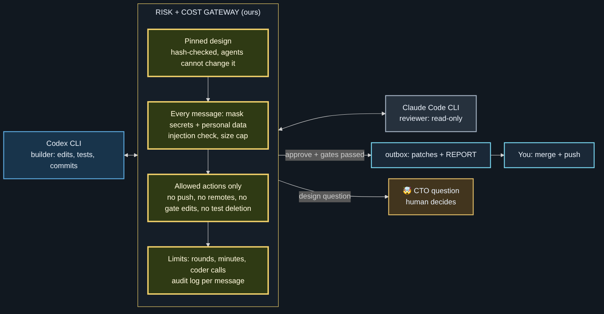
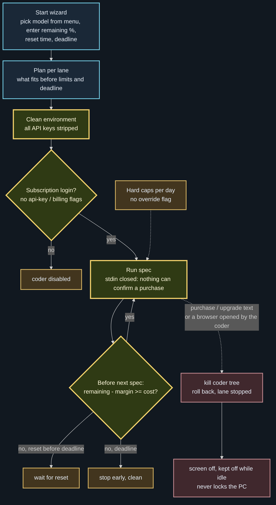

# NightCoder: Draft to Done

*Personal multi-agent orchestrator. Research and code that run overnight, for one night or three.*

> v1 working, v2 in progress (updated 2026-10-27). The portfolio overview and the original proposed architecture live in
> [ai-multi-agent-orchestration](https://github.com/ai-agent-orchestrator/ai-multi-agent-orchestration).
> This repository documents the design. The NightCoder source code (`nc2.py`, `distill.py`, `nc_guard.py` and their tests) is kept private for personal use.

*v1 as it runs today: one PC, no server, zero API spend.*

## Idea

A free local model shrinks and masks every draft first. Google does the thinking, Claude designs and reviews, Codex and Claude Code build. A security and cost layer sits between every step and never relies on an agent's goodwill.

Principle: two or three strong agents beat a swarm of weak bots, unless the workflow is fixed in advance. Connecting strong agents is what every developer wants to try; the part that must not be skipped is the risk and cost module between them.

| Role | Agent | Runs on | Cost |
| --- | --- | --- | --- |
| Privacy gateway: mask + compress drafts | Meta Llama via Ollama | local PC | free |
| Brain: research reasoning, product PRD | Google Gemini CLI | Google account | free tier |
| CTO: design, contracts, specs, final review | Claude | subscription | subscription |
| Engineering lead: build, test, commit | Codex CLI | subscription | subscription |
| Second builder or reviewer | Claude Code CLI | subscription | subscription |
| Relay and gates | NightCoder v2 (`nc2.py`) | local PC | free |
| Second opinion on diffs (optional) | `gemini-api` (Gemini API CLI) | API key, free tier | capped |

## Two modes: Research and Code

**Mode A: Research.** Draft pile → masked brief → Gemini CLI returns a to-do prompt, a to-do list, a table and a keyword / cause-and-effect flow. Next step: send them to Google Docs, Tasks and Calendar (Keep is left out because its API is limited for personal accounts).

**Mode A in detail (v2, in progress).**

- Sources: X bookmarks, reposts and private topic lists (official API only), YouTube channels (official API only, short summaries for top-tier channels, a watch list for the rest), and exported AI chat logs.
- Source tiers: S ×3, A ×1.5, B ×1, P ×0.5 (new follows start on probation). A private core list is read first; when a cap is hit, P is dropped first, then B, then A. S is never dropped. Promotions are suggested, never applied automatically.
- Redaction first: a name dictionary that stays on the PC, masking, and a leak scanner. Raw text never leaves the PC; private notes pass an extra gate before anything goes to Google.
- The local model keeps a running summary per category, then builds daily tables: to-do, content, trends, interesting.
- Google AI Mode pack: one prompt pack the human pastes into Google's AI Mode (no API, no scraping). Saved answers flow back in.
- Emoji board: ⬜ unseen · 😍 love · 😁 pass · 🧐 see again (+1 / +3 / +7 days) · 🤯 deep dive in AI Mode · 💡 idea. Keyboard aliases (`-`, `!!`, `ok`, `?`, `!?`, `*`) for devices without emoji input.
- Alarm layer: one Google Calendar event per due line in a dedicated calendar (`calendar.app.created` scope only), editable times that survive the next sync, plus Google Tasks. Detailed plans stay in Keep, linked from the board.

**Mode B: Code (1 to 3 nights).** Idea pile → masked brief → Gemini writes a PRD in market language (customer, problem, positioning, MUST / SHOULD / LATER, no implementation) → Claude turns it into Codex specs with real function signatures, scope and forbidden files → NightCoder feeds the specs to `codex exec` one by one and gates every result → Claude reviews the patches → you push.

## NightCoder gates (do not trust the agent's report)

1. The work is committed and nothing is left uncommitted.
2. Git remotes did not change during the task; NightCoder never pushes and refuses a Codex command line that mentions push.
3. Diff guard: secrets, protected and forbidden files, scope, deleted or skipped tests.
4. NightCoder re-runs the full test suite itself.
5. One fix round with the failure shown to Codex; then the work is saved to `nc2/failed/<task>`, the branch is rolled back and the queue stops.
6. Codex usage limit: partial work is undone, the spec stays queued, the run stops quietly.

Results land in `outbox/<task>/` as UTF-8 patches plus `REPORT.md`; `outbox/STATUS.md` is a one-glance status page for a phone or tablet.

## Security and cost layer (v1)

| Control | Where |
| --- | --- |
| Masking of keys, e-mail, phone, resident numbers, card / account numbers before any model sees the text | `distill.py`, `nc_guard.py` |
| Raw drafts never leave the PC; the cloud receives one compressed brief, max 12,000 characters | `distill.py` |
| Injection check on agent replies (discarded or flagged) | `nc_guard.find_injection` |
| Diff guard before anything is accepted | `nc_guard.check_diff` |
| Daily call caps, size caps, chunk cache so reruns only process new text | `nc2.py`, `distill.py` |
| Ledger of every task, failed work kept on backup branches, push only by a human | `nc2.py` |

## Cost + risk management module (Agent Risk Gateway)

The part that is mandatory. Every agent-to-agent message, every coder start and every spec passes it. It is built from the v1 guard, the legal-service guard and wallet, and the NightCoder gates, and is planned to be extracted as a separate module.

| Risk | Control |
| --- | --- |
| Private data leak | masking, local name dictionary, separated zones (raw / redacted), leak scanner before anything leaves the PC |
| Prompt injection | Unicode normalization (NFKC, invisible characters removed, spaced letters joined), injection check; untrusted text is quoted data, never instructions |
| Fake code, skipped checks | NightCoder re-runs the tests, diff guard, test-tampering check |
| Design drift | design files pinned by hash; a design change becomes a question for the human (🤯), never an edit |
| Runaway cost | caps on rounds, minutes and coder calls; budgets alert at 80% and stop at 100%; wait for resets instead of retrying |
| Irreversible actions | no push, no remote changes, rollback on failure, audit log per message |
| Extra payment | four independent layers, below |

### Codex ⇄ Claude Code without the human in the loop

Builder edits and runs tests; reviewer is read-only and answers in a fixed JSON shape (approve / changes / question). Every message is masked, injection-checked and size-capped. A conversation ends as 😁 passed (patches in the outbox), 🤯 question for the human, or 🧐 stopped at a limit with the work saved on a backup branch.

### No extra payment, by construction

1. **Clean start.** Coders start with an allowlisted environment; every API key variable is removed. Command lines with API-key flags, billing words or push are refused. A lane runs only if the coder is logged in with a subscription.
2. **No way to say yes.** Coders run non-interactive with stdin closed. Any purchase or upgrade text in the output kills the coder's process tree, rolls back, and stops that lane (🛑). Daily hard caps have no override flag, and a spec cannot switch the lock off.
3. **Screen off.** On a purchase prompt, or a browser started by a coder, the display is turned off and kept off while the PC is idle. The PC is never locked and the user is never fought while active. Cleared by an explicit acknowledge command.
4. **Account settings.** Extra usage and auto-reload are turned off in the subscription accounts (a one-time checklist).

### Credit-aware scheduling

No official remaining-quota API is assumed. At start, a wizard asks per coder: model (menu, item 1 = the CLI's own default), remaining % of the current window, reset time, one deadline, and a safety margin (default 15%). NightCoder plans what fits per lane, never starts a spec that would cross the margin or the deadline, waits for a reset when it comes before the deadline, and learns the real cost per effort and model. A daytime reserve (e.g. 30% from 08:00 to 23:00) keeps a share for interactive use.

Security hits stop only the spec or lane they belong to; other lanes keep running. Cost stops are clean: a spec is never cut off halfway.

## NightCoder v2 (in progress)

| Step | What |
| --- | --- |
| N1–N4 | done: dated stop time, usage-limit cooldown with reset parsing, keep-awake, phone-friendly status |
| N5 | coder per spec: `coder: codex \| claude \| any` |
| N6 | several lanes in parallel in one process, `after:` dependencies between specs |
| N7 | one status page for all lanes (😁 / 🧐 / ⏳), missing credentials disable only what needs them |
| N8 | Codex ⇄ Claude Code loop through the risk gateway |
| N9 | no-overage lock, screen guard, usage meter, scheduler, start wizard |

## Target runtime (later)

The early server design from [ai-multi-agent-orchestration](https://github.com/ai-agent-orchestrator/ai-multi-agent-orchestration), kept, with the modules built in [legal-intake-rag-service](https://github.com/ai-agent-orchestrator/legal-intake-rag-service) placed in their slots. Our rules do the first, cheaper pass; NVIDIA NeMo Guardrails stays an optional second layer.

| Slot | Module (ours) | What it does |
| --- | --- | --- |
| Cost slot A | Credit wallet | reserve credits before work starts |
| Input guard | Dynamic Guard, rate limiter, masking | per-reason scores, session lock at 100, distributed injection across the last 5 messages, Unicode normalization |
| Every model call | GuardedLLM | reserve → call → settle with reported or estimated usage |
| Output guard | Output checks | canary leak, extraction budget, 8-gram copy ratio, hallucinated source removal |
| Cost slot B | Credit wallet | settle actual usage, monthly cap, never negative |
| Accounting | Audit, funnel, metrics | hash-only audit, funnel / ROI, tenant-scoped Prometheus metrics |
| Agent tasks | NightCoder gates | worktree isolation, diff guard, test re-run, rollback |

## What changed from the early design

| Role | Early design | v1 | Why |
| --- | --- | --- | --- |
| Compression workers | Cloud workers | Meta Llama via Ollama, local | free; drafts stay on the PC |
| Input / output guard | NVIDIA NeMo Guardrails | our rules (`nc_guard` + legal-service guard) | same job without the install; NeMo returns as an optional layer |
| Agent sandbox | NVIDIA NemoClaw / OpenShell | git worktree + NightCoder gates | rollback on failure, remote-change detection, no push |
| Orchestrator | FastAPI server + task queue | `nc2.py` + `inbox/` / `outbox/` folders | runs for nights on one PC; files are the queue and the status page |
| Spend | usage accounting | zero API spend | a paid API coder was tried and dropped for low code quality |

## Development flow

| Phase | Goal | Done when |
| --- | --- | --- |
| 1 · done | v1 on one PC: `nc2.py` + `distill.py`, first real Codex task, Ollama and Gemini CLI login | one spec goes inbox → outbox with a passing `REPORT.md` |
| 2 · now | Two lanes (Codex + Claude Code), risk gateway, no-overage lock, credit-aware scheduling | a two-lane queue finishes unattended over two nights with no extra payment possible |
| 3 | Draft to Done daily pilot: X / YouTube / chat logs → tiers → board → AI Mode pack → Calendar + Tasks | one morning run produces the board, the pack and the alarms |
| 4 | Extract the Agent Risk Gateway; server runtime with cost slots A + B; port guard, masking, wallet, audit; NeMo optional; guard + cost layer packaged as a Gemini CLI extension / MCP server | the runtime passes the same guard and billing tests as the legal service |

## Status

- Built and tested offline: `nc2.py` (29 tests with a real git repo and a fake Codex), `distill.py` (8 tests with a fake Ollama server and a fake brain CLI).
- Running on the PC with the real Codex CLI; Draft to Done steps R1–R7 implemented by Codex under NightCoder.
- In progress: N5–N9 (lanes, Claude Code as second coder, risk gateway, no-overage lock), calendar sync, leak scanner and budgets.
- Default models: whatever each CLI is set to; a spec changes the model only with an explicit header.
- Lesson that shaped v1: a paid API model writing whole files produced facade implementations for integration work; agentic coders that run the tests themselves did the same work correctly and faster. NightCoder therefore orchestrates and gates, and never writes code itself.

Diagram sources: `assets/diagrams/nightcoder-*.mmd` (Mermaid, rendered with the same dark theme as ai-multi-agent-orchestration).
