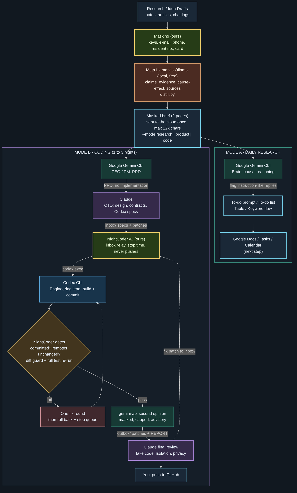
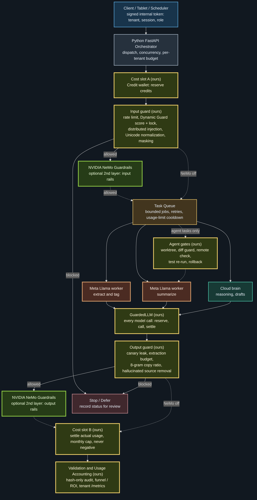
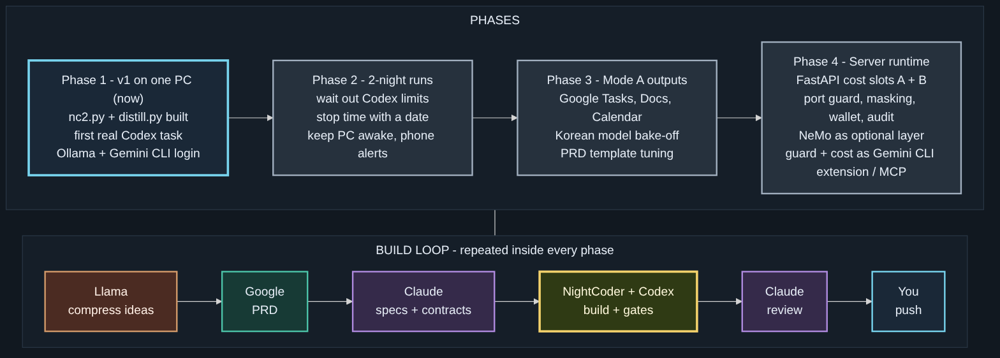

# NightCoder: Draft to Done

*Personal multi-agent orchestrator. Research and code that run overnight, for one night or three.*

> v1, first working version (2026-10-27). The portfolio overview and the original proposed architecture live in
> [ai-multi-agent-orchestration](https://github.com/ai-agent-orchestrator/ai-multi-agent-orchestration).
> This repository documents the design. The NightCoder source code (`nc2.py`, `distill.py`, `nc_guard.py` and their tests) is kept private for personal use.

*v1 as it runs today: one PC, no server, zero API spend.*

## Idea

A free local model shrinks and masks every draft first. Google does the thinking, Claude translates and reviews, Codex builds. A security and cost layer sits between every step and never relies on an agent's goodwill.

| Role | Agent | Runs on | Cost |
| --- | --- | --- | --- |
| Privacy gateway: mask + compress drafts | Meta Llama via Ollama | local PC | free |
| Brain: research reasoning, product PRD | Google Gemini CLI | Google account | free tier |
| CTO: design, contracts, specs, final review | Claude | subscription | subscription |
| Engineering lead: build, test, commit | Codex CLI | subscription | subscription |
| Relay and gates | NightCoder v2 (`nc2.py`) | local PC | free |
| Second opinion on diffs (optional) | `gemini-api` (Gemini API CLI) | API key, free tier | capped |

## Two modes: Research and Code

**Mode A: Research.** Draft pile → masked brief → Gemini CLI returns a to-do prompt, a to-do list, a table and a keyword / cause-and-effect flow. Next step: send them to Google Docs, Tasks and Calendar (Keep is left out because its API is limited for personal accounts).

**Mode B: Code (1 to 3 nights).** Idea pile → masked brief → Gemini writes a PRD in market language (customer, problem, positioning, MUST / SHOULD / LATER, no implementation) → Claude turns it into Codex specs with real function signatures, scope and forbidden files → NightCoder feeds the specs to `codex exec` one by one and gates every result → Claude reviews the patches → you push.

## NightCoder gates (do not trust the agent's report)

1. The work is committed and nothing is left uncommitted.
2. Git remotes did not change during the task; NightCoder never pushes and refuses a Codex command line that mentions push.
3. Diff guard: secrets, protected and forbidden files, scope, deleted or skipped tests.
4. NightCoder re-runs the full test suite itself.
5. One fix round with the failure shown to Codex; then the work is saved to `nc2/failed/<task>`, the branch is rolled back and the queue stops.
6. Codex usage limit: partial work is undone, the spec stays queued, the run stops quietly.

Results land in `outbox/<task>/` as UTF-8 patches plus `REPORT.md`; `outbox/STATUS.md` is a one-glance status page for a phone or tablet.

## Security and cost layer

| Control | Where |
| --- | --- |
| Masking of keys, e-mail, phone, resident numbers, card / account numbers before any model sees the text | `distill.py`, `nc_guard.py` |
| Raw drafts never leave the PC; the cloud receives one compressed brief, max 12,000 characters | `distill.py` |
| Injection check on agent replies (discarded or flagged) | `nc_guard.find_injection` |
| Diff guard before anything is accepted | `nc_guard.check_diff` |
| Daily call caps, size caps, chunk cache so reruns only process new text | `nc2.py`, `distill.py` |
| Ledger of every task, failed work kept on backup branches, push only by a human | `nc2.py` |

## Target runtime (later)

The early server design from [ai-multi-agent-orchestration](https://github.com/ai-agent-orchestrator/ai-multi-agent-orchestration), kept, with the modules built in [legal-intake-rag-service](https://github.com/ai-agent-orchestrator/legal-intake-rag-service) placed in their slots. Our rules do the first, cheaper pass; NVIDIA NeMo Guardrails stays an optional second layer.

| Slot | Module (ours) | What it does |
| --- | --- | --- |
| Cost slot A | Credit wallet | reserve credits before work starts |
| Input guard | Dynamic Guard, rate limiter, masking | per-reason scores, session lock at 100, distributed injection across the last 5 messages, Unicode normalization |
| Every model call | GuardedLLM | reserve → call → settle with reported or estimated usage |
| Output guard | Output checks | canary leak, extraction budget, 8-gram copy ratio, hallucinated source removal |
| Cost slot B | Credit wallet | settle actual usage, monthly cap, never negative |
| Accounting | Audit, funnel, metrics | hash-only audit, funnel / ROI, tenant-scoped Prometheus metrics |
| Agent tasks | NightCoder gates | worktree isolation, diff guard, test re-run, rollback |

## What changed from the early design

| Role | Early design | v1 | Why |
| --- | --- | --- | --- |
| Compression workers | Cloud workers | Meta Llama via Ollama, local | free; drafts stay on the PC |
| Input / output guard | NVIDIA NeMo Guardrails | our rules (`nc_guard` + legal-service guard) | same job without the install; NeMo returns as an optional layer |
| Agent sandbox | NVIDIA NemoClaw / OpenShell | git worktree + NightCoder gates | rollback on failure, remote-change detection, no push |
| Orchestrator | FastAPI server + task queue | `nc2.py` + `inbox/` / `outbox/` folders | runs for nights on one PC; files are the queue and the status page |
| Spend | usage accounting | zero API spend | a paid API coder was tried and dropped for low code quality |

## Development flow

| Phase | Goal | Done when |
| --- | --- | --- |
| 1 · now | v1 on one PC: `nc2.py` + `distill.py`, first real Codex task, Ollama and Gemini CLI login | one spec goes inbox → outbox with a passing `REPORT.md` |
| 2 | 2-night runs: wait out Codex limits, dated stop time, keep the PC awake, phone alerts | a 10-spec queue finishes unattended overnight |
| 3 | Mode A outputs to Google Tasks, Docs, Calendar; Korean model bake-off; PRD template tuning | one draft pile becomes a Doc, tasks and calendar entries in one command |
| 4 | Server runtime with cost slots A + B; port guard, masking, wallet, audit; NeMo optional; guard + cost layer packaged as a Gemini CLI extension / MCP server | the runtime passes the same guard and billing tests as the legal service |

## Status

- Built and tested offline: `nc2.py` (29 tests with a real git repo and a fake Codex), `distill.py` (8 tests with a fake Ollama server and a fake brain CLI).
- Not yet verified: the real Codex CLI, Ollama and Gemini CLI connections on the PC (Phase 1).
- Lesson that shaped v1: a paid API model writing whole files produced facade implementations for integration work; agentic coders that run the tests themselves did the same work correctly and faster. NightCoder therefore orchestrates and gates, and never writes code itself.

Diagram sources: `assets/diagrams/nightcoder-*.mmd` (Mermaid, rendered with the same dark theme as ai-multi-agent-orchestration).
