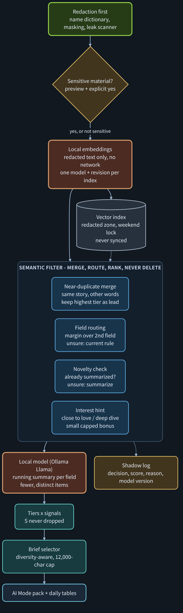

# Research: semantic filter for the local summarizer

*Design proposal, 2026-11-06, waiting for the owner's decision. Not built. Part of Product 1 (Research, Draft to Done).*

The local Llama summarizer reads every new item, even when five sources tell the same story in different words. A semantic filter in front of it turns redacted items into embedding vectors and uses cosine similarity to merge duplicates, route items to fields, skip what was already summarized, and keep the 12,000-character brief diverse. It runs on the PC, reads only redacted text, and never deletes an item: it merges, routes, ranks and logs.

[](../assets/diagrams/nightcoder-semantic-filter-dark.svg)

## 1. Two ideas this rests on

- **Cosine similarity** measures how closely two vectors point the same way. Closer to `1` means the two texts mean more nearly the same thing. With normalized vectors it is just the dot product.
- **Semantic search** embeds items and queries into the same vector space and picks the nearest ones, so it finds an item that means the same thing even when no words overlap ("the central bank held rates" vs "no change from the Fed").

Two cautions shape every rule below:

1. A similarity score is closeness, not truth, importance or quality.
2. The absolute value depends on the model. Some models (the E5 family, for example) give even unrelated text fairly high scores. So no fixed cut-off like `0.8` is used. Every threshold is a margin or rank rule, calibrated on our own items and stored with a version.

## 2. Where it sits in the pipeline

```text
inputs -> redaction -> sensitive gate -> [embed] -> [semantic filter] -> local Llama summaries
       -> tiers x signals -> [brief selector] -> AI Mode pack / daily tables / board
```

Only the bracketed steps are new. Redaction, the sensitive-material gate, tiers and signals, the board and the alarms stay as they are.

## 3. The five jobs

| Job | Compares | Rule (calibrated, versioned) | Output | When unsure |
| --- | --- | --- | --- | --- |
| Near-duplicate merge | today's items in the same window (start: 72 h) | mutual nearest neighbours above the calibrated duplicate line | one lead item per story, others listed as "also from"; signal weights added up to a cap | keep both |
| Field routing | item vs field prototypes (macro, geopolitics, AI, miltech, innovation, culture) | top field wins only if its margin over the second field is large enough | field label | current routing rule |
| Novelty check | item vs items already summarized in that field (last N days) | near-duplicate of a summarized item and no new numbers or names | "already covered" note, no new summary call | summarize |
| Interest hint | item vs items you marked 😍 or 🤯 | small bonus, capped below one list signal (1) | extra signal, shown as a suggestion | no bonus |
| Brief selector | candidates for the 12,000-character brief | rank by tier x signal with a diversity penalty (MMR) so near-identical items do not use up the budget | ordered brief | current order |

Field prototypes start as the centroid of 10–20 hand-labelled redacted items per field, re-built when you change labels.

## 4. Hard rules

- **Redacted text only.** The embedder receives the same redacted text the summarizer receives. A test asserts that raw-zone text never reaches it.
- **Never delete.** The filter merges, routes, reorders and annotates. Every decision is written to the shadow log with score, reason and model version, and merged items stay visible under their lead item.
- **Tiers win.** An S item is never dropped or demoted by the filter. In a merge, the lead is the highest tier, then the highest signal. The existing cap order (P, then B, then A; never S) is unchanged.
- **No network.** The embedding model loads from local files. A socket guard in the tests fails any outbound connection.
- **Embeddings are personal data.** Vectors derive from your feeds, so they live in the redacted zone, are covered by the weekend lock, and are never synced or put in a pack.
- **Injection-aware.** A similarity score cannot run instructions, but text can be stuffed to look like your interests. So the filter only influences ranking, the existing injection check still runs on the text, and the brief keeps a per-source share cap.
- **One model per index.** Model, revision, dimension and normalization are stored with the index. Changing any of them means a new index and a full re-embed, never mixed vectors.

## 5. Model and storage

| Option | Why | To check on this PC |
| --- | --- | --- |
| `intfloat/multilingual-e5-large-instruct` (MIT, 1024-d, 512 tokens) via sentence-transformers | strong multilingual retrieval for a Korean + English feed; same model planned in legal-intake-fastapi-lab, so lessons transfer | RAM/VRAM, time per run, pinned revision, offline load |
| An embedding model served by Ollama | one local runtime next to Llama | which model, quality on our labels |

Qwen models are not used, following the same decision as the Legal Intake project. Input is the title plus the start of the redacted text, cut to fit the model's token limit with its own tokenizer.

No framework is required. The whole search is a normalized matrix and one dot product in plain Python with NumPy (`scores = vectors @ query`). The open-source LangChain library could wrap the same step for free, but it adds a dependency without adding a capability here. LangSmith, the hosted tracing service, is not used: it would send data off the PC.

Storage starts as a flat local file (vectors + item IDs). Brute-force search should be enough at a few thousand items a day; measure it before adding anything. The vectors stay outside memvid by default, because the memory layer currently keeps keyword (BM25) search first and does not store external embeddings. Moving them behind the memvid boundary later is a separate decision. The interface stays the same either way:

```text
embed(items) -> vectors
nearest(vector, scope, k) -> [(item_id, score)]
add(item_ids, vectors)
```

## 6. Calibrate and measure on your own board

| Set | Size to start | Source |
| --- | --- | --- |
| Same-story pairs (yes / no) | 100 pairs | real redacted history, labelled by you |
| Field labels | 60 items | the per-field summaries you already keep |
| Interest labels | from the board | 😍 / 🤯 vs 😁 marks |

- Pick thresholds on one half and check them once on the other half. Store the chosen values with a version.
- **Merges hide items, so precision comes first.** Target near-zero wrong merges before chasing recall.
- Report per run: summarize calls saved, distinct stories per brief, characters saved, "unsorted" rate, time per run.
- **Shadow week first.** The filter computes and logs its decisions but changes nothing. Then compare its log with what you marked on the board before turning any job on.

## 7. Tests (offline, like the existing suite)

- A deterministic fake embedder for unit tests; the real model only in one separately marked smoke test.
- S items are never dropped; merged items stay listed; unsure cases pass through unchanged.
- No raw-zone text reaches the embedder; no outbound network; the index refuses a vector with the wrong model or dimension.
- The brief never exceeds 12,000 characters and respects the per-source cap.

## 8. Rollout

| Step | Turns on | Done when |
| --- | --- | --- |
| R1 | shadow log only | one week of logs, no output change |
| R2 | near-duplicate merge + brief selector | no wrong merge found in a week of board review |
| R3 | field routing + novelty check | "unsorted" rate and saved summary calls reported |
| R4 | interest hint (suggestion only) | hints compared with 😍 / 😁 marks for two weeks |
| R5 (optional) | move storage behind the memvid boundary | only after a decision allows vectors in memvid; same tests pass behind the interface |

## 9. Open questions

- Which embedding runtime fits next to Llama on this PC, and how many seconds per morning run are acceptable?
- Duplicate window: 24 h or 72 h?
- Should the interest hint exist at all, or only appear as a board suggestion?
